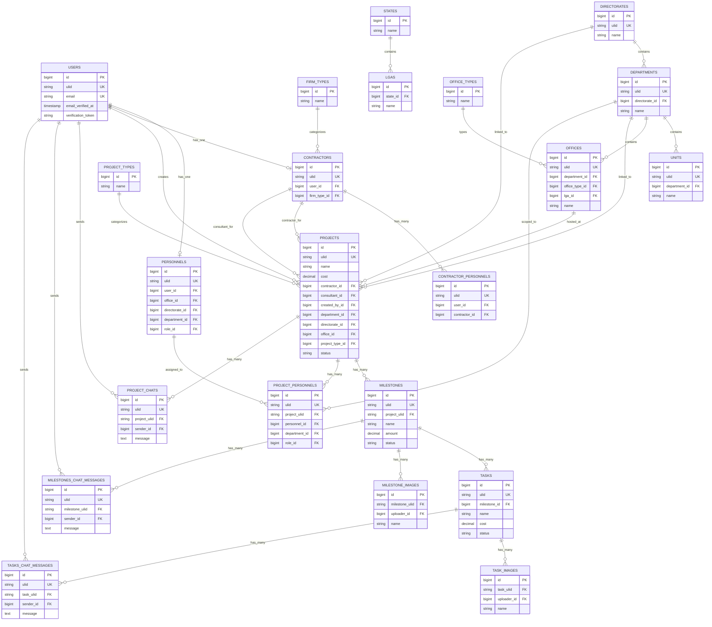

# Database ERD and Data Layer Guide

## Overview

This app uses Laravel Eloquent with a mixed key strategy:

- numeric IDs for many local relations
- ULIDs for public references and several cross-table relationships

That mix is important when modifying queries or adding foreign keys.

## Core Entity Map

```text
User
  |-- Personnel
  |-- Contractor
         |-- ContractorPersonnel

Directorate
  |-- Department
         |-- Unit
         |-- Office

State
  |-- Lga

ProjectType
Project
  |-- belongsTo Contractor (contractor_id)
  |-- belongsTo Contractor (consultant_id)
  |-- belongsTo Directorate
  |-- belongsTo Department
  |-- belongsTo Office
  |-- belongsTo User (creator)
  |-- hasMany Milestone via project_ulid
  |-- hasMany ProjectPersonnel via project_ulid

Milestone
  |-- belongsTo Project via project_ulid
  |-- hasMany Task via milestone_id
  |-- hasMany MilestoneImage via milestone_ulid

Task
  |-- belongsTo Milestone via milestone_id
  |-- hasMany TaskImage via task_ulid

Chats
  ProjectChat -> Project via project_ulid
  MilestoneChatMessage -> Milestone via milestone_ulid
  TaskChatMessage -> Task via task_ulid
```

## Mermaid ER Diagram



Notes:

- This Mermaid ERD is based on migrations and model relationships, not on a generated database dump.
- Some relationships are modeled here as the business domain likely intends them, even where current Eloquent methods are inconsistent.
- Known mismatches in code, such as `ProjectChat::project()` using the wrong foreign key, are documented later in this file.

## Main Tables

### Users and Auth

Primary files:

- `database/migrations/0001_01_01_000000_create_users_table.php`
- `database/migrations/2024_06_19_092655_add_two_factor_columns_to_users_table.php`
- `database/migrations/2025_03_17_112235_create_notifications_table.php`
- `database/migrations/2024_06_19_100638_create_permission_tables.php`

Important columns in `users`:

- `id`
- `ulid`
- `email`
- `email_verified_at`
- `verification_token`
- soft delete columns

Behavior notes:

- email verification is custom-token based
- user roles come from Spatie tables, not from a direct `role` column

## Organization Structure

Tables:

- `organizations`
- `directorates`
- `departments`
- `units`
- `offices`
- `office_types`
- `states`
- `lgas`
- `regions`

Practical hierarchy used by the app:

```text
Organization
  -> Directorate
    -> Department
      -> Unit
      -> Office
```

Notes:

- `Office` also links to `Lga` and office type
- some model relationships are likely under-modeled as `hasOne`

## External Firms and Personnel

Tables:

- `contractors`
- `contractor_personnels`
- `firm_types`

Interpretation:

- contractor and consultant are both stored in `contractors`
- `firm_type_id` distinguishes categories
- app logic treats:
  - `firm_type_id = 1` as contractor
  - `firm_type_id = 2` as consultant

Risk:

- business meaning is enforced in PHP code, not by enum or stricter DB design

## Project Delivery Tables

### Projects

Primary schema file:

- `database/migrations/2024_08_05_172439_create_projects_table.php`

Important columns:

- `ulid`
- `name`
- `description`
- `cost`
- `duration`
- `duration_period`
- `contractor_id`
- `consultant_id`
- `created_by_id`
- `department_id`
- `directorate_id`
- `project_type_id`
- `office_id`
- `status`
- `award_letter`
- `deleted_by`
- soft deletes

Project relations in code:

- `belongsTo Directorate`
- `belongsTo Department`
- `belongsTo Unit`
- `belongsTo Office`
- `belongsTo ProjectType`
- `belongsTo Contractor as contractor`
- `belongsTo Contractor as consultant`
- `belongsTo User as creator`
- `hasMany Milestone via project_ulid`
- `hasMany ProjectPersonnel via project_ulid`

### Milestones

Primary schema file:

- `database/migrations/2024_08_19_174418_create_milestones_table.php`

Important columns:

- `ulid`
- `project_ulid`
- `name`
- `cost_type`
- `amount`
- `deadline`
- `status`
- `deleted_by`
- soft deletes

Important design choice:

- milestone links to project using project ULID, not project numeric ID

### Tasks

Primary schema file:

- `database/migrations/2024_08_19_174625_create_tasks_table.php`

Important columns:

- `ulid`
- `milestone_id`
- `name`
- `description`
- `start_date`
- `due_date`
- `cost`
- `gap`
- `status`
- `deleted_by`
- soft deletes

Important mismatch:

- migration uses soft deletes
- `app/Models/Task.php` does not use `SoftDeletes`

Risk: High

### Project Personnel Assignments

Key schema file:

- `database/migrations/2024_09_06_030009_create_project_personnels_table.php`

Meaning:

- join-like assignment table connecting a project to an internal personnel record
- stores role assignment per project

Main fields from model:

- `project_ulid`
- `personnel_id`
- `department_id`
- `role_id`
- `created_by_id`

Important note:

- project assignment also changes the user’s global Spatie role in controller logic

## Media and Collaboration Tables

Tables:

- `project_chats`
- `tasks_chat_messages`
- `milestones_chat_messages`
- `task_images`
- `milestone_images`

Pattern:

- chats and image records use ULID linkage to parent entity
- senders/uploaders point back to `users`

Known bug:

- `app/Models/ProjectChat.php` maps `project()` using `task_ulid` instead of `project_ulid`

## Notifications and Settings

Tables:

- `notifications`
- `settings`

Use cases:

- notifications store in-app copies of project/account events
- settings appear to hold organization/admin signature and report-related configuration

## Role and Permission Model

Seeded from:

- `app/Constants/RoleAndPermissions.php`
- `database/seeders/RolesAndPermissionsSeeder.php`

Categories:

- category 1: organization/admin roles
- category 2: project roles

This matters because controllers often filter roles with `role_category_id`.

## Status Model

The app uses a shared enum-like concept for `status`:

- `pending`
- `in_progress`
- `done`
- `completed`
- `archive`
- `cancelled`

Defined in code by:

- `app/Enums/Status.php`

Practical note:

- business logic often checks string literals like `'done'` directly, not only enum values

## Data Access Patterns

### Typical Query Style

- direct Eloquent in controllers
- moderate eager loading with `with(...)`
- limited repository/service abstraction

### Business Logic in Models

`Project` contains:

- milestone totals
- paid/remaining cost
- progress percentage
- completion propagation
- time-left formatting

`Milestone` contains:

- task totals
- progress percentage
- completion propagation to project

`Task` contains:

- mark-as-done propagation to milestone

## High-Risk Schema/Model Mismatches

| Issue | Location | Risk |
|---|---|---|
| `Task` soft delete mismatch | migration vs `app/Models/Task.php` | High |
| wrong relation key in `ProjectChat` | `app/Models/ProjectChat.php` | High |
| likely `hasOne` should be `hasMany` | `Directorate`, `Department` models | Medium |
| mixed ULID/ID relation strategy | across delivery tables | Medium |
| role semantics enforced in app logic | contractor/consultant distinction | Medium |

## Safe Change Guidance

Safer data-layer changes:

- adding read-only scopes
- adding missing indexes after reviewing query patterns
- adding explicit relationship methods without removing old ones yet

High-risk data-layer changes:

- changing ULID linkage strategy
- changing project/personnel role assignment tables
- changing status values
- changing contractor/consultant semantics
- changing notification payload shape

## Recommended Next Data-Layer Steps

1. Draw a real ERD from migrations before modifying schema.
2. Audit all ID vs ULID relationships.
3. Fix model/schema mismatches one by one with tests.
4. Add tests for completion propagation:
   - task -> milestone
   - milestone -> project
5. Add tests around project personnel role synchronization.
